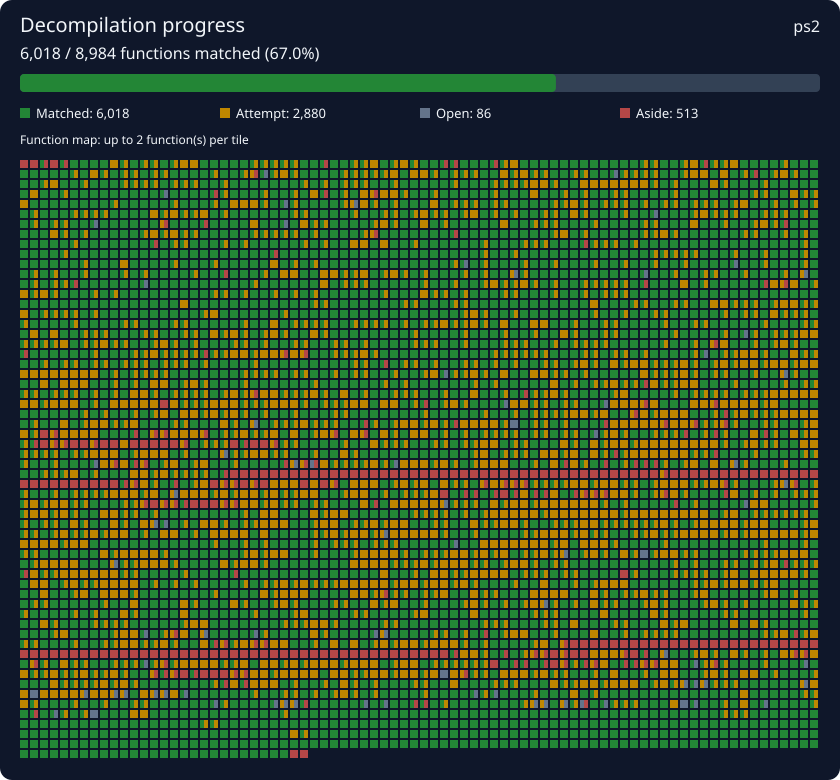

# Champions of Norrath (SLUS-20565) — decompilation progress

[](https://discord.gg/pUrzXK8ghQ)

This is a saved decompilation project created with
[decompdecomp](https://github.com/n-delic/decompdecomp). AI agents have worked
on the decompilation; C attempts are kept as matches only when they pass
decompdecomp's byte-for-byte comparison.

## Project details

- **Game:** SLUS-20565, Champions of Norrath
- **Platform:** PlayStation 2
- **Compiler:** EE-GCC 2.96
<!-- decompdecomp:progress:start -->
- **Progress:** 6018 matching function(s), 3080 best attempt(s)
- **Completion:** 6,018 / 8,984 functions (67.0%). 513 set aside, excluded from completion.
<!-- decompdecomp:progress:end -->

## Install decompdecomp

Install the latest release from the
[decompdecomp releases page](https://github.com/n-delic/decompdecomp/releases).

- **Windows 10/11:** Download and run the Windows x64 setup executable.
- **Linux:** Follow the installation instructions for your distribution in the
  [decompdecomp README](https://github.com/n-delic/decompdecomp#install).
- **Windows PS2 requirement:** The period PS2 compilers run in WSL 2. In an
  administrator PowerShell, run `wsl --install`, restart if asked, and open
  Ubuntu once to finish setup. See
  [Microsoft's WSL installation guide](https://learn.microsoft.com/windows/wsl/install).
- **macOS:** Not supported by the current release.

When decompdecomp offers to install PS2 compilers, review and accept their
licenses before proceeding.

## Download and open the project

Clone the repository:

```sh
git clone https://github.com/ensapra/champions-of-norrath.git
cd champions-of-norrath
```

Alternatively, use **Code → Download ZIP** on the GitHub repository page and
extract the archive. In decompdecomp, choose **New project → Open a saved
project**, then select the cloned or extracted project folder. Provide your own
matching copy of the game when prompted. You can also open this checkout's
`progress/` folder, which contains this README and `decompdecomp.json`.

The progress data contains a game fingerprint (SHA-1), compiler settings,
function source, and project notes—not the game itself. Do not commit or share
your game image, BIOS files, or other copyrighted game data.

## What's in the progress folder

This folder is the saved project state intended for sharing and version control.
It holds no game data. The main files are:

```text
src/<function>.c      matched C for a function
best/<function>.c     closest saved attempt for an unmatched function
include/common.h      shared declarations used by the functions
decompdecomp.json     game fingerprint, compiler settings, function state, notes
README.md             this guide
```

To continue on another computer, open decompdecomp and load the saved project
folder along with your own copy of the game. decompdecomp checks the game and
rejudges saved functions; a match is established by the byte-for-byte result,
not by a status entry alone.

## Collaborating and pull requests

Join the [project Discord channel](https://discord.com/channels/762922174263590983/1563215091292307476)
to coordinate tasks and avoid overlapping work. Before editing a function,
check its current state and ask whether someone else is working on it.

1. Fork the repository on GitHub, or create a branch if you have write access.
2. Make a focused change to the saved project. Keep function changes, shared
   header updates, notes, and related metadata together where appropriate.
3. Use decompdecomp to compile and compare the function against your own game.
   Report the result accurately; compiling without a byte-for-byte match is not
   a completed match.
4. Review the diff and remove unrelated changes. Never include game files,
   generated game data, or local configuration.
5. Push your branch and open a pull request against the repository's default
   branch. Include the function/task, a brief explanation, verification results,
   and any relevant Discord discussion.
6. Respond to review feedback and keep the PR focused until it is approved.

Only contribute or share material you have the right to distribute. Follow the
repository's license and maintainer guidance.

<!-- decompdecomp:visuals:start -->
## Progress map



Green: matched. Gold: attempted. Grey: open. Red: set aside. Functions follow address, then source unit and name order.
The image and tagged counts update on save. Keep project notes outside the hidden `decompdecomp` comment pairs to preserve them.
<!-- decompdecomp:visuals:end -->
